# Sim2Act

[](pyproject.toml)
[](manuscript/Sim2Act_AIC_Manuscript1031.docx)
[](MODEL_CARD.md)
[](CITATION.cff)

Research code and materials for **Simulation-supervised view ranking for
budget-constrained 2.5D crack mapping**.

**Si Chen, Yuyang Bao, Longsheng Bao, Jiakang Zhao, and Ling Yu**

Shenyang Jianzhu University; Inner Mongolia University of Science and Technology

Sim2Act-CrackTwin, abbreviated as **Sim2Act**, learns which view to reveal next
when surface crack mapping has a limited observation budget. It ranks a fixed
pool of registered cameras from revealed evidence and known geometry, then
updates a shared 2.5D crack state through a frozen fusion backend.

The final manuscript reports both the benefit on semi-synthetic scenes and the
reversal on real structures. This repository follows the **October 31, 2026
Word version** and includes its original figures, core research source, and
protocol documentation. Trained weights and benchmark data are not bundled.

## Highlights

- **Simulation supervision:** one-step changes in surface-band IoU provide
  candidate-ranking targets under the same frozen backend used for evaluation.
- **Pre-reveal information constraint:** the selector uses 16 global-state
  features and 24 candidate-local features. Candidate RGB, unrevealed
  predictions, reference labels, and realized gains are excluded from its inputs.
- **Compact view ranker:** shared feature encoders and masked mean/max pooling
  form a 70,785-parameter candidate-set model.
- **Controlled comparison:** every selector uses the same OmniCrack30k
  predictor and two-class CS-Max fusion.
- **Mixed transfer outcome:** raw AUC improves over Coverage-NBV on 208
  semi-synthetic test scenes, while Coverage-NBV performs better on the five
  real structures. The evaluated set context has no resolved additional benefit
  over LocalMLP on the semi-synthetic test.

## Task and Information Boundary

The benchmark supplies a registered surface and camera pool. Starting from
three revealed views, the selector chooses one unrevealed camera at each step.
Only after this decision is that camera's cached evidence released and fused.
The geometry and registration costs are outside the evaluated view budget.

<div align="center">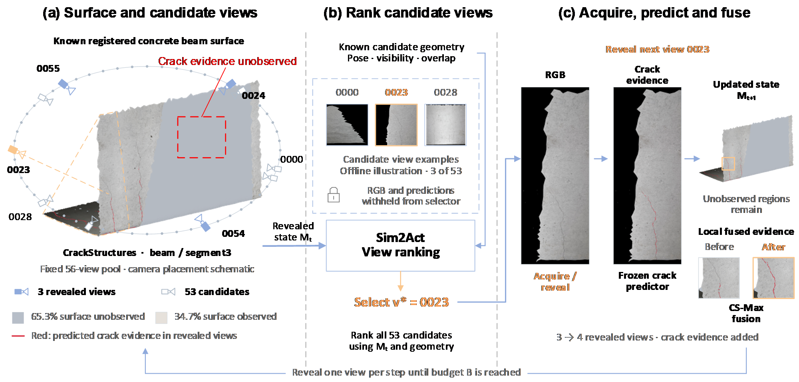</div>

## Visual Overview

Offline development evaluates each candidate independently from the same state
to obtain numerical surface-band IoU gains, including negative gains. At
evaluation time, both the trained ranker and its training-fitted scaler are
frozen. All methods share the reveal-and-fuse interface.

<div align="center">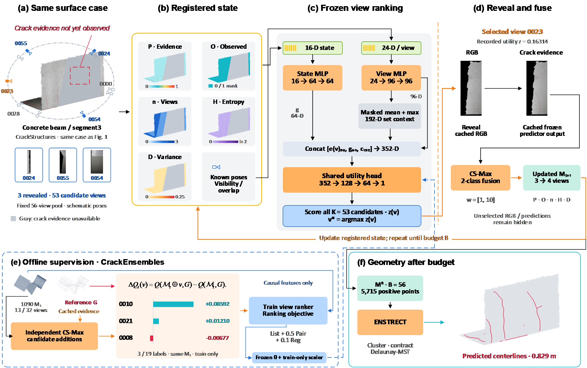</div>

Sim2ActViewRanker encodes the global state as `16 → 64 → 64` and each candidate
as `24 → 96 → 96`. Masked mean/max pooling supplies 192 dimensions of set
context. A `352 → 128 → 64 → 1` head scores each valid candidate. LinearRanker
and LocalMLP provide controls for learned scoring and candidate-set context.

<div align="center">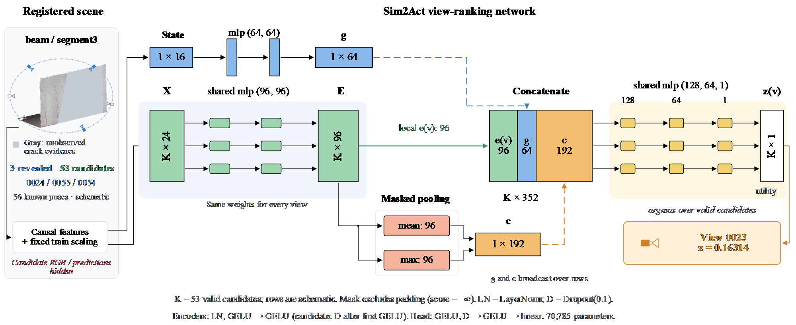</div>

## Passive Fusion Benchmark

The passive comparison establishes the mapping backend used throughout the
active experiments. CS-Max maintains separate background and crack evidence;
adding a view can reduce semantic IoU even though class evidence maxima only
increase. The all-view result is therefore a reference endpoint.

<div align="center">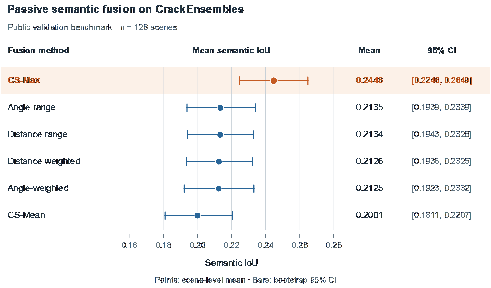</div>

## Results

The primary metric is **normalized raw surface-band IoU AUC**, using a 10 mm
reference-band radius. Raw curves retain decreases in mapping quality. A
best-so-far envelope and reference-target view counts are retrospective
diagnostics and do not define a deployable stopping rule.

| Method | Semi-synthetic: 208 scenes | Real: five structures |
| --- | ---: | ---: |
| Random | 0.7523 | 0.7790 |
| Coverage-NBV | 0.7592 | 0.8340 |
| Defect-Prior-NBV | 0.6914 | 0.7982 |
| Uncertainty-NBV | 0.6915 | 0.8022 |
| LinearRanker | 0.8156 | 0.7446 |
| LocalMLP | 0.8324 | 0.7172 |
| **Sim2Act** | **0.8305** | **0.6986** |
| Oracle-NBV (privileged) | 1.0368 | 0.8965 |

Oracle-NBV accesses reference labels and unrevealed evidence. It is a
privileged greedy reference, with no claim of global sequence optimality.
Normalization uses the all-view endpoint, so normalized AUC may exceed one.
The real set contains 15 positive segments grouped within five structures;
these segments are not 15 independent assets.

### Semi-synthetic Evaluation

Sim2Act exceeds Coverage-NBV by `+0.071312` raw AUC, with a paired
scene-bootstrap 95% confidence interval of `[+0.051434, +0.090927]`. Its
difference from LocalMLP is `−0.001877`, with interval
`[−0.005432, +0.001354]`; this does not resolve an added benefit from the
evaluated set-context configuration.

<div align="center">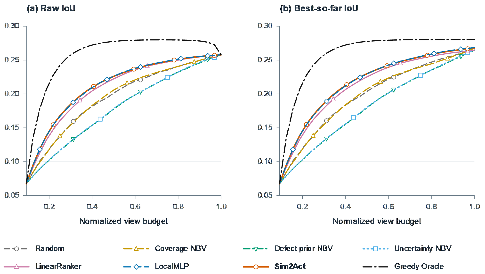</div>

The view-count and regret analyses below use evaluator-side reference
information. For example, `17.62` versus `21.95` views to a reference target is
an offline diagnostic, not demonstrated savings in prospective field capture.

<div align="center">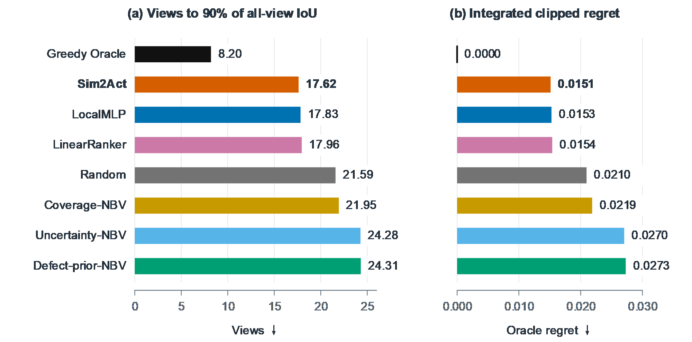</div>

### Real Zero-shot Evaluation

No CrackStructures training, fine-tuning, scaler recalibration, or checkpoint
selection is performed. On the five real structures, Sim2Act reaches `0.6986`
raw AUC, compared with `0.8340` for Coverage-NBV and `0.7172` for LocalMLP.
This transfer result is a central finding of the final manuscript.

<div align="center">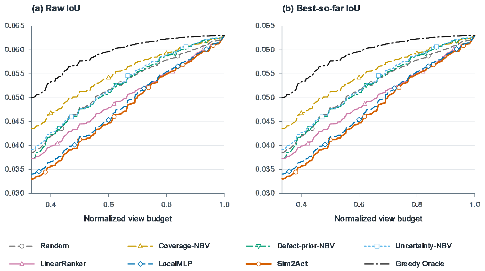</div>

The Bridge B example compares maps at matched view budgets. Coverage-NBV
performs best in this illustrated case; the learned policy's behavior must be
interpreted alongside false-positive evidence and the fixed fusion rule.

<div align="center">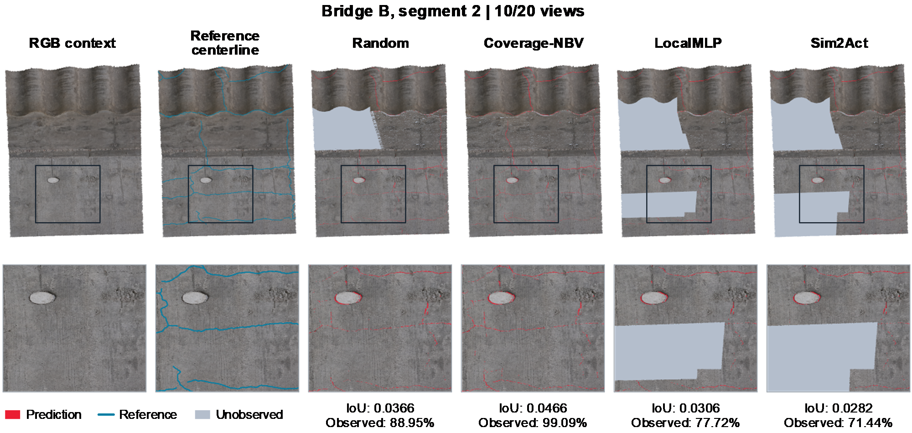</div>

## Reference-band Sensitivity

The direction of the transfer result persists at reference radii of 5, 10,
and 20 mm: Sim2Act improves over coverage on semi-synthetic scenes and falls
below it on the real structures. These bands describe neighborhoods of supplied
reference centerlines, not measured physical crack widths.

<div align="center">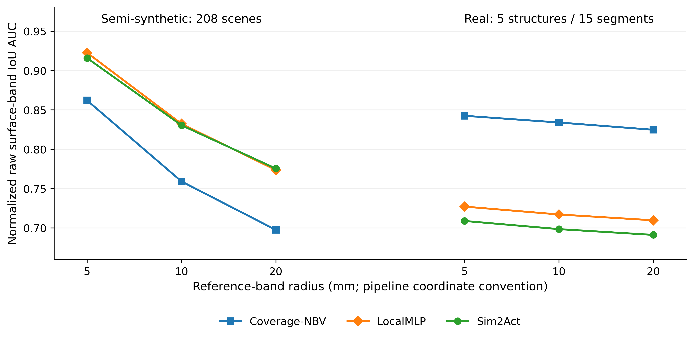</div>

## Negative Controls

Three reference-empty segments from an additional structure provide a
false-positive diagnostic. They are kept separate from the positive-structure
evaluation and do not establish deployment safety.

<div align="center">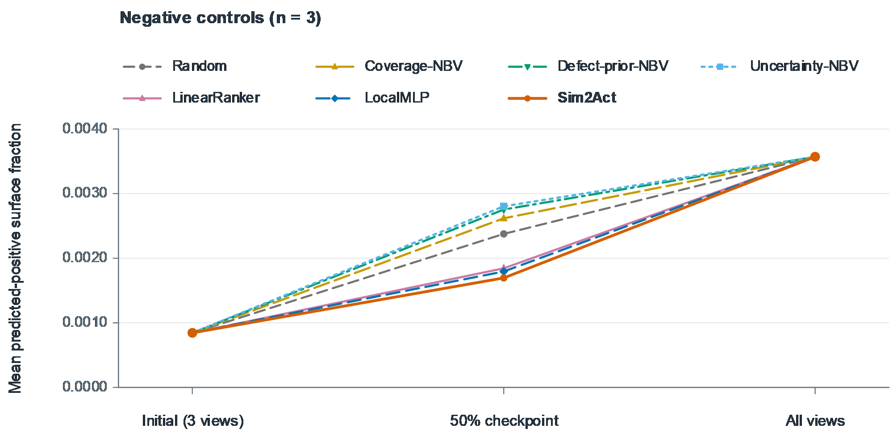</div>

## Mapping Metric Interpretation

Surface-band IoU measures binary agreement over sampled surface points.
Tolerance-based centerline agreement evaluates extracted line localization
using a different counting domain. A real example shows why these outputs and
scores are not interchangeable.

<div align="center">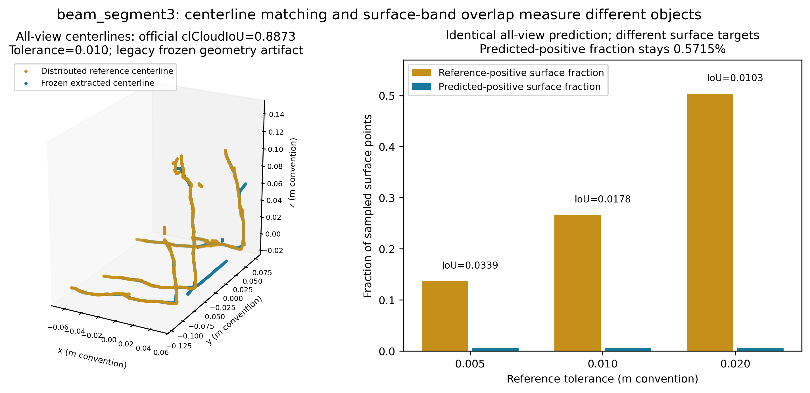</div>

## Efficiency

Sim2ActViewRanker has 70,785 trainable parameters. The reported mean cumulative
selector times are `35.884 s` for Sim2Act and `1.322 s` for Coverage-NBV in the
semi-synthetic evaluation, and `38.74 s` versus `1.47 s` on the real set.
These figures describe the evaluated selector pipeline, including feature
work, rather than network-only latency or physical survey time.

## Release Contents

```text
Sim2Act/
  assets/figures/                 # all 11 figures from the final Word
  checkpoints/README.md           # weight availability and requirements
  configs/paper_sim2act.json      # manuscript protocol metadata
  docs/
    DATASET_PROTOCOL.md
    REPRODUCIBILITY.md
    SOURCE_PROVENANCE.md
    results/                     # curated primary raw-AUC values
  manuscript/
    Sim2Act_AIC_Manuscript1031.docx
    SHA256SUMS.txt
  src/sim2act_baselines/
    sim2act/                     # ranker, features, losses, supervision
    active/, passive/, cache/    # selectors, fusion, evidence APIs
    evaluation/, extraction/     # metrics and geometry components
  tests/                         # focused tests of the research APIs
  CITATION.cff
  MODEL_CARD.md
  THIRD_PARTY_NOTICES.md
  pyproject.toml
  requirements.txt
```

The Word file is preserved byte for byte. Figure PNGs are exported from its
embedded figures, with their source mapping recorded in
[assets/figures/manifest.json](assets/figures/manifest.json).

## Installation

```bash
git clone https://github.com/sisisichen/Sim2Act.git
cd Sim2Act
python -m venv .venv
```

Windows PowerShell:

```powershell
.\.venv\Scripts\Activate.ps1
```

Linux/macOS:

```bash
source .venv/bin/activate
```

Install the core package:

```bash
python -m pip install -e .
```

The core depends on NumPy. Neural ranking additionally requires PyTorch for
your CPU/CUDA platform; cache and geometry operations require the relevant
optional dependencies described in [docs/REPRODUCIBILITY.md](docs/REPRODUCIBILITY.md).

## Model Interface

With PyTorch installed, the final ranker accepts a batch of global features,
candidate features, and a validity mask:

```python
import torch
from sim2act_baselines.sim2act.step5b_models import make_model

model = make_model("Sim2ActViewRanker").eval()
global_features = torch.zeros(1, 16)
candidate_features = torch.zeros(1, 8, 24)
valid_candidates = torch.ones(1, 8, dtype=torch.bool)

with torch.no_grad():
    scores = model(global_features, candidate_features, valid_candidates)
print(scores.shape)  # torch.Size([1, 8])
```

This checks the interface with an untrained model. For trained selection, load
the matching checkpoint and apply its training-fitted scaler to the documented
features. The example does not reproduce a manuscript score.

## Training and Evaluation

The release exposes the research modules for state sampling, causal feature
extraction, exact one-step supervision, ranking losses, training, closed-loop
selection, and evaluation. The original remote orchestration and external
caches are not included as a portable command-line pipeline.

See [docs/REPRODUCIBILITY.md](docs/REPRODUCIBILITY.md) for module entry points,
environment requirements, and the distinction between core checks and full
benchmark reproduction. [configs/paper_sim2act.json](configs/paper_sim2act.json)
records the paper settings; it is protocol metadata, not a complete runner
configuration.

## Data and Checkpoints

Third-party images, surfaces, annotations, caches, and upstream predictors are
not redistributed here. The public-data development split and real-structure
grouping are described in [docs/DATASET_PROTOCOL.md](docs/DATASET_PROTOCOL.md).

Trained rankers and scalers are not bundled. See
[checkpoints/README.md](checkpoints/README.md). The manuscript identifies
Yuyang Bao, [yuyang.bao@outlook.com](mailto:yuyang.bao@outlook.com), as the
corresponding author for study-specific material requests.

## Reproducibility

The primary table is provided as
[docs/results/primary_raw_auc.csv](docs/results/primary_raw_auc.csv). The
publication date and DOI are not asserted; the included document is the final
local manuscript version supplied for this release. Its data/code availability
paragraph predates this repository's source release.

Record the Git revision, split and cache provenance, model/scaler hashes,
reference-band radius, initialization seeds, numeric precision, and aggregation
unit when reproducing an experiment. Keep raw trajectories distinct from
retrospective envelopes.

## Third-party Dependencies and License

Dependencies and upstream datasets retain their own terms. See
[THIRD_PARTY_NOTICES.md](THIRD_PARTY_NOTICES.md). A redistribution license for
the study-specific source and manuscript has not been specified in the
provided project; this repository does not assign one on the authors' behalf.

## Citation

GitHub reads the repository citation from [CITATION.cff](CITATION.cff).

```bibtex
@misc{chen2026sim2act,
  title  = {Simulation-supervised view ranking for budget-constrained 2.5D crack mapping},
  author = {Chen, Si and Bao, Yuyang and Bao, Longsheng and Zhao, Jiakang and Yu, Ling},
  year   = {2026},
  note   = {Manuscript},
  url    = {https://github.com/sisisichen/Sim2Act}
}
```
